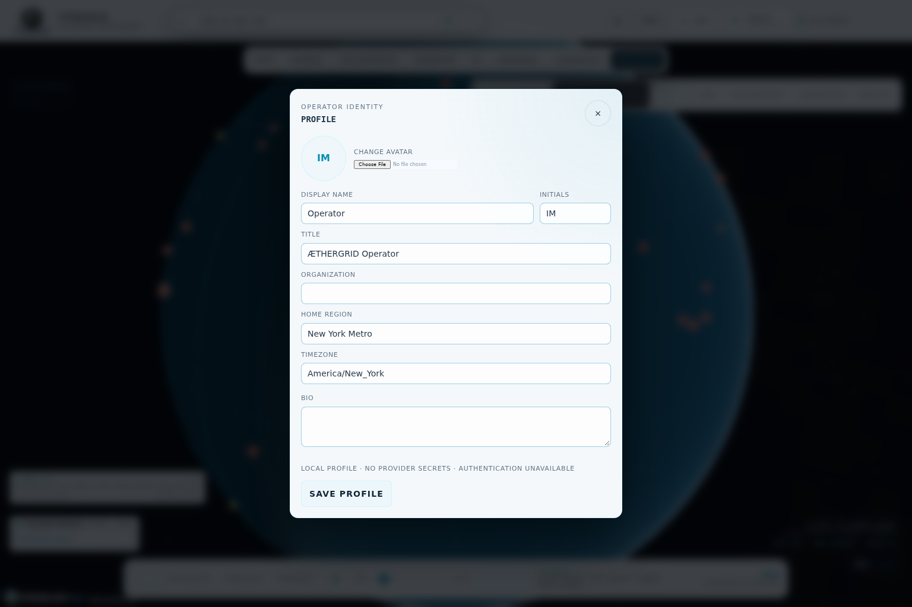
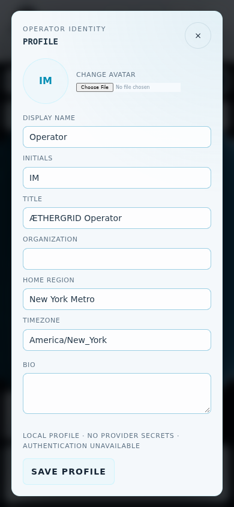
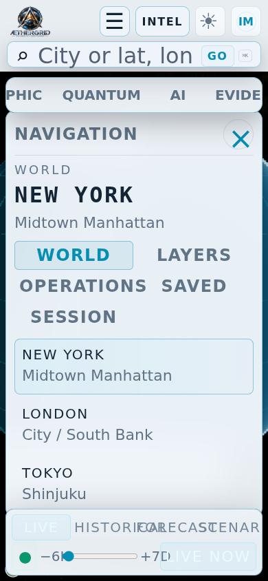

# Production foundation acceptance — 2026-10-11

This is a frontend foundation checkpoint. Authentication remains unavailable until Jules publishes the authenticated identity/login/logout/role contract. The existing profile endpoint stores a local operator profile and is not login.

Source baseline: main and released v0.2.1 `9b61b86e674d2bd35f7fcfb6ecf71fec7d6e5283`. Initial published source tree `73aae9e3cd176efb232551cb805e9a074894395f` exactly matches the local tree at `6bd2dfb`; GitHub connector commit `4eb468babc26e6034c9ea36a5de75a0078566095`. A subsequent evidence update strengthens the text enlargement check and adds these actual captures.

## Verified locally

- Node 22.23.3: TypeScript/Vite build and fresh full `npm run check` passed.
- Root suite: 534 passed, zero failures/skips. Coverage 92.44% lines, 75.16% branches, 94.78% functions; existing thresholds unchanged.
- Compiled canonical production suite: 16 passed. Seven light viewports (1536×1024, 1440×900, 1366×768, 1024×768, 768×1024, 390×844, 844×390); OS/system changes and rejected persistence; readiness unknown/stale state and late unmounted response; modal keyboard ownership; drawer focus; mapped source badge.
- Actual text enlargement: a separate strengthened test doubles computed text sizes, verifies action reachability and waits for visible navigation before capture; 1 passed. This replaces a browser text-size-adjust declaration that did not demonstrate effective enlargement.
- Compiled regression suite: 17 passed, including credential-free real Cesium globe/OSM New York geometry, workspace transitions, specialist/local-runtime provenance, compact drawers, weather unit contracts and NOAA missing-value withholding.
- Independent review found no critical issues. Light surfaces/action contrast, review coverage and active-drawer profile focus findings were addressed.

Browser: Chromium 153.0.8010.0, Linux, ANGLE/SwiftShader software GPU. Software rendering does not certify physical mobile GPU performance. Offline mocked provider/source receipts are contract evidence, never live-provider availability evidence. Credentialed terrain/imagery/building tiles and authenticated access control have not been certified here.

## Published checks

At initial source head `4eb468b`: Engineering CI run 38122242671 and CodeQL run 38122242643 succeeded. Browser CI run 38122242668 was still running when this evidence document was written. Follow the PR checks for final exact-head status; prior-head successes must not be substituted for a changed head.

## Actual compiled-app captures

No image substitutes for spatial geometry. These captures record operator surfaces over the running interactive renderer. D-Wave remains on hold and non-executable.
